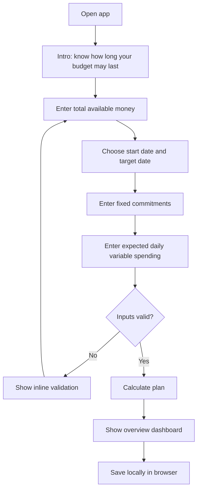
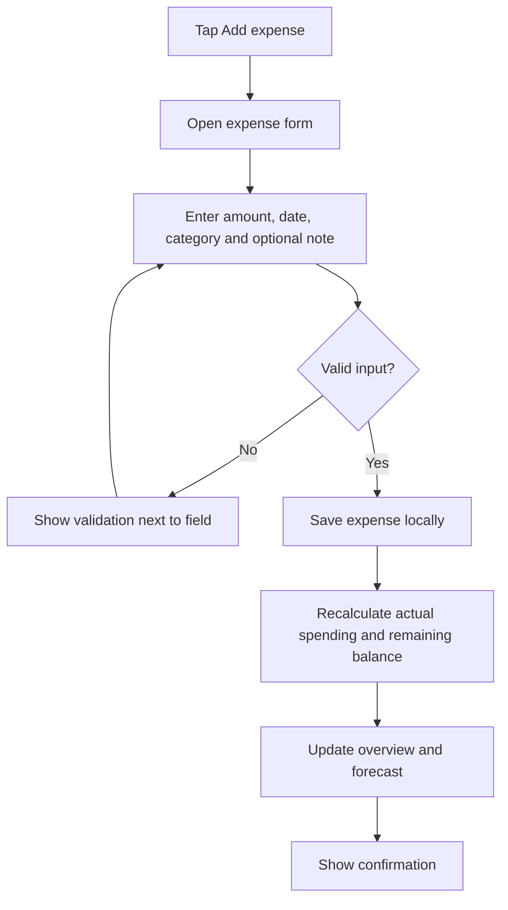
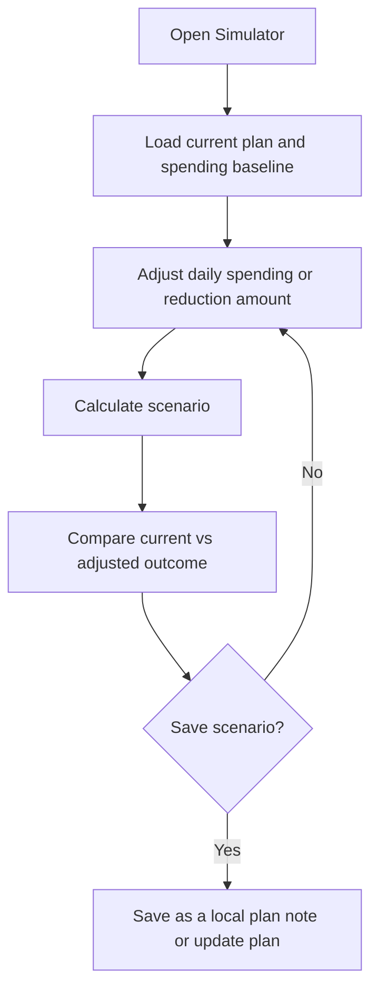
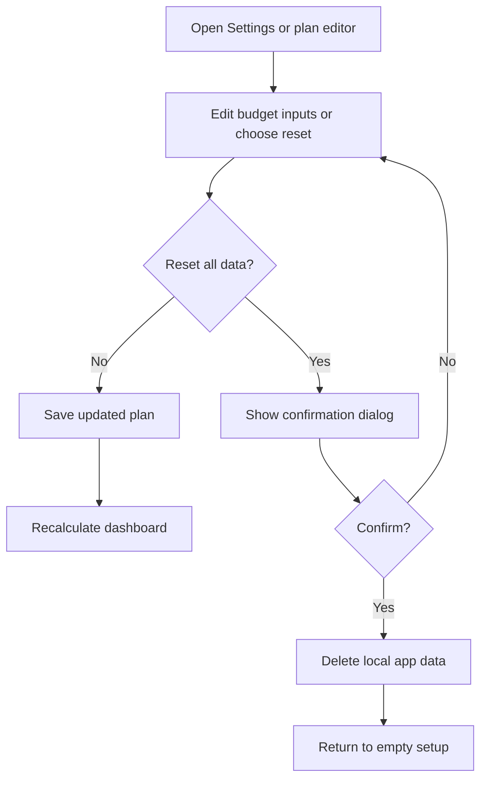

# Budget Survival Calculator
## Product Requirements, UX/UI Design & User Flow

**Document type:** Product / UX / Technical Overview  
**Project type:** Responsive web tool  
**Status:** MVP specification  
**Primary language:** Arabic (RTL), with architecture ready for English (LTR)  
**Working name:** Budget Survival Calculator  
**Suggested Arabic name:** ميزانيتي تكفّي؟

---

## 1. Product Summary

Budget Survival Calculator is a lightweight personal-budgeting web tool that helps a person understand how long their available money may last, set a practical daily spending limit, record expenses, and test how spending changes affect their remaining budget.

The product should answer four questions quickly:

1. How much money can I actually use after known commitments?
2. How much can I spend per day until my target date?
3. At my current spending pace, when might my available balance run out?
4. If I reduce or increase spending, how does the forecast change?

The product is an educational planning aid, not financial advice and not a guarantee of future spending outcomes.

### Product principles

- **Fast to understand:** the core result should be visible without navigating multiple pages.
- **Useful before account creation:** the MVP works without sign-up.
- **Transparent calculations:** explain which inputs produce each result.
- **No shame-based messaging:** use neutral, supportive language.
- **Privacy by default:** MVP data stays in the user's browser.
- **Mobile-first and accessible:** usable on small screens, keyboard, and screen readers.
- **Honest uncertainty:** forecasts are estimates based on assumptions and recorded data.

---

## 2. Goals and Non-Goals

### Goals

- Calculate a daily spending allowance for a chosen period.
- Estimate budget runway using a user-provided spending rate or recorded expenses.
- Track expenses by amount, date, and category.
- Show remaining money and budget progress.
- Let users test hypothetical spending changes in a simulator.
- Make the product easy to demo, share, and explain on LinkedIn.
- Keep the first release small enough for one developer to build and test.

### Non-goals for the MVP

- Bank-account integrations or automatic transaction imports.
- Investment, lending, credit-score, or financial-product recommendations.
- AI-based financial advice.
- Multi-user household budgets.
- Cloud sync, accounts, or paid subscriptions.
- Automatic detection of recurring bills.
- Claims that the forecast is guaranteed or perfectly predictive.

---

## 3. Target Users and Use Cases

### Primary audiences

- Students managing a fixed allowance.
- People budgeting between paydays.
- Freelancers or workers managing a known amount for a period.
- Travelers planning a trip budget.
- Anyone who wants a quick estimate without learning a full accounting app.

### Main use cases

1. A student has EGP 6,000 and needs it to last 30 days.
2. A user records daily expenses and wants to know whether spending is above their plan.
3. A user has fixed bills coming up and wants to subtract them before setting a daily limit.
4. A user tests whether reducing daily spending by EGP 20 would make a meaningful difference.
5. A user wants to reset the plan for a new period.

---

## 4. Scope and Release Plan

### MVP — required

- Responsive landing/dashboard experience.
- Currency selection, defaulting to EGP.
- Budget setup form.
- Start date and target date / number of days.
- Fixed commitments entered as a total.
- Daily variable-spending estimate.
- Calculation summary.
- Expense create, edit, and delete.
- Expense categories.
- Remaining balance and budget progress.
- Forecast based on a clearly stated method.
- What-if spending simulator.
- Local persistence in the browser.
- Empty, validation, loading (if needed), and error states.
- Accessible keyboard and form behavior.
- Unit tests for financial calculations.

### Version 1.1 — useful improvements

- Multiple fixed commitments with due dates.
- Income expected during the plan period.
- Search and filtering for expenses.
- Export expenses as CSV.
- More informative forecast based on a rolling average.
- Arabic/English language switch.

### Later, only if users request it

- Optional accounts and cloud synchronization.
- Multiple budgets (e.g., monthly, trip, emergency period).
- Installable PWA.
- Reminders, only with explicit opt-in.
- Shareable result card that does not expose personal financial data by default.

---

## 5. Information Architecture

Suggested MVP navigation:

- **Overview** — primary dashboard and core calculations.
- **Expenses** — transaction list and expense management.
- **Simulator** — compare current and adjusted spending.
- **Settings** — currency, language, privacy, and data reset.

For the smallest implementation, Overview, Expenses, and Simulator can be sections in a single-page app. Avoid adding unnecessary pages before testing the MVP.

### Suggested route structure

```text
/
  Overview
/expenses
  Expense list and form
/simulator
  What-if simulator
/settings
  Preferences and local data controls
```

A single-page version can use tabs or anchored sections instead of separate routes.

---

## 6. Core User Flow

### Flow A — First visit and initial setup



**Behavior:**
- No account or sign-in required.
- The user can edit inputs after setup.
- Explain that fixed commitments are deducted once from the total available amount.
- If the user has already entered expenses, explain whether those expenses are included in the remaining balance to prevent double subtraction.

### Flow B — Add an expense



Required expense fields:
- Amount.
- Date.
- Category.

Optional:
- Note / merchant description.

Suggested categories:
- Food & groceries.
- Transport.
- Housing & bills.
- Education / work.
- Health.
- Shopping.
- Entertainment.
- Other.

Allow custom categories later; they are not required for the MVP.

### Flow C — What-if simulator



The simulator must be reversible and must not silently alter the user's actual budget. Use explicit actions such as **Apply this plan** and **Reset scenario**.

### Flow D — Edit or reset the plan



---

## 7. Screen-by-Screen UX Specification

## 7.1 Welcome / Setup

### Purpose
Collect the minimum inputs needed to create a useful budget plan.

### Content
- Product name and simple logo.
- Headline: **Know how long your money may last.**
- Supporting text: “Build a simple plan from your available balance, upcoming commitments, and daily spending.”
- Main form:
  - Total available amount.
  - Currency (EGP default).
  - Plan start date.
  - Target date or duration.
  - Fixed commitments total.
  - Expected daily variable spending.
- Primary button: **Calculate my budget**.
- Privacy note: “Your plan is stored on this device in this version.”

### UX rules
- Use numeric input with appropriate decimal handling.
- Show currency beside amounts.
- Prevent negative amounts.
- Target date must be on or after the start date.
- Fixed commitments cannot exceed the total available amount without a clear warning and a blocked or explicitly confirmed plan.
- If daily spending is zero, show a special state instead of dividing by zero.
- Keep labels visible; do not rely on placeholders as labels.

## 7.2 Overview Dashboard

### Primary hierarchy
1. Current remaining balance.
2. Daily spending limit for the selected period.
3. Forecasted runway / estimated end date.
4. Budget progress and spending trend.
5. Recent expenses.
6. Main actions: Add expense, Edit plan, Open simulator.

### Suggested dashboard cards

**Card A — Available balance**
- Label: “Available after commitments”
- Value: remaining plan balance.
- Helper: “Starting amount minus commitments and recorded expenses, according to the selected accounting mode.”

**Card B — Daily limit**
- Label: “Suggested daily limit”
- Value: remaining spendable amount divided by remaining days.
- Helper: “A planning target, not a spending guarantee.”

**Card C — Estimated runway**
- Label: “At your current pace”
- Value: estimated number of days remaining.
- Helper: show the spending baseline used, such as “based on your entered daily estimate” or “based on your recent average.”

**Card D — Plan status**
- Neutral states:
  - “Within plan”
  - “Spending above target”
  - “More data needed”
  - “Commitments exceed available money”
- Avoid alarmist colors or guilt-inducing copy.

### Charts
- Balance forecast line chart over the remaining plan period.
- Optional category breakdown only after enough expenses exist.
- Always provide a textual summary or table equivalent to the chart.
- Do not display a misleading smooth forecast if the calculation only uses a constant daily average.

### Empty state
If no expenses have been entered:
- Explain that the estimate uses the initial daily-spending assumption.
- CTA: “Add your first expense.”
- Do not imply that actual behavior has already been observed.

## 7.3 Expenses

### Layout
- Page title: “Expenses”.
- Total spent in selected period.
- Add expense button.
- Expense list / table.
- Filters: date range and category.
- Each item shows date, category, note (if present), and amount.
- Actions: edit and delete.

### Add/edit form
- Amount (required, greater than zero).
- Date (required; default to today in the user's local date).
- Category (required).
- Note (optional).
- Save and Cancel actions.

### Validation and feedback
- Inline field-level errors.
- Confirm before deleting an expense.
- Announce successful saves accessibly.
- Empty state explains how to add the first transaction.

## 7.4 Simulator

### Purpose
Help users compare scenarios without changing the underlying records.

### Inputs
- Baseline daily spend.
- Reduction or increase amount, or a target daily amount.
- Optional one-time upcoming expense (later feature).

### Results
- Current estimated runway.
- Scenario estimated runway.
- Difference in estimated days.
- Estimated balance on the target date.
- A short explanation of the calculation.

### Actions
- **Apply this plan** — explicitly updates the plan's daily-spending assumption.
- **Reset scenario** — returns to the current baseline.
- Do not change expense history when applying a scenario.

### Guardrails
- Clamp the simulated daily spend to zero or above.
- If scenario spend is zero, explain that this model does not predict budget exhaustion from daily spending alone.
- If fixed commitments or future income are not modeled over time, clearly state that limitation.

## 7.5 Settings and Privacy

- Currency selection.
- Language selection if localization is implemented.
- Privacy explanation.
- Export data (CSV) if included.
- Reset all local data.
- App version.

Reset must require confirmation and explain that the action cannot be undone unless an export exists.

---

## 8. Design System

### Visual direction
A calm, modern personal-finance tool. It should feel trustworthy and practical, not like a trading terminal or a bank marketing site.

### Suggested palette

Use design tokens so the palette can be changed without rewriting components.

```css
:root {
  --color-background: #F7F8FA;
  --color-surface: #FFFFFF;
  --color-text: #17202A;
  --color-muted: #667085;
  --color-border: #E4E7EC;
  --color-primary: #2563EB;
  --color-primary-hover: #1D4ED8;
  --color-success: #15803D;
  --color-warning: #B45309;
  --color-danger: #B42318;
  --radius-card: 16px;
  --radius-control: 10px;
}
```

Use semantic color meaning consistently. Do not communicate status by color alone; pair it with text or an icon.

### Typography
- Suggested font: a readable Arabic UI font such as **IBM Plex Sans Arabic** or **Noto Sans Arabic**.
- Use a compatible Latin font fallback.
- Clear hierarchy:
  - Page title: 24–32 px desktop; 22–26 px mobile.
  - Card value: 24–32 px.
  - Body: 14–16 px.
  - Helper text: 12–14 px, with adequate contrast.
- Use tabular numerals for amounts and chart labels where supported.

### Layout
- Desktop: centered content, max width around 1120–1200 px.
- Desktop navigation: compact sidebar or top navigation; avoid both if unnecessary.
- Tablet: two-column card grid where space allows.
- Mobile: single-column layout, full-width primary action, no horizontal overflow.
- Spacing scale: 4, 8, 12, 16, 24, 32, 40 px.
- Cards: white surface, subtle border, 16 px radius, minimal shadow.
- Inputs and buttons: touch targets ideally at least 44 × 44 px.

### RTL and localization
- Arabic is the primary MVP language.
- Set `dir="rtl"` at the document or app-shell level for Arabic.
- Use logical CSS properties (`margin-inline`, `padding-inline`, `inset-inline-start`) rather than hard-coded left/right values.
- Format dates and currency using `Intl.NumberFormat` and `Intl.DateTimeFormat`.
- Keep numeric entry predictable; test Arabic and Latin digits.
- If English is added, switch to `dir="ltr"` and verify charts, navigation, forms, and icons.

### Interaction states
Every interactive element should support:
- Default.
- Hover (where relevant).
- Keyboard focus.
- Disabled.
- Invalid.
- Loading (only for genuinely asynchronous actions).
- Success / confirmation.
- Empty state.

### Accessibility
- Semantic landmarks and headings.
- Visible keyboard focus.
- Labels associated with every input.
- Errors linked to their input and explained in text.
- Sufficient text/background contrast.
- Charts with textual summaries.
- Do not use color as the only indicator.
- Respect reduced-motion preferences.
- Dialogs manage focus and can be dismissed by keyboard where appropriate.

---

## 9. Calculation Model and Business Rules

The product must distinguish between **plan assumptions**, **recorded transactions**, and **forecasts**.

### Recommended MVP accounting model

Inputs:
- `startingBalance`: money available at plan start.
- `fixedCommitments`: total commitments to reserve for the period.
- `startDate`: plan start date.
- `targetDate`: desired end date.
- `plannedDailySpend`: estimated variable spending per day.
- `expenses[]`: recorded transactions with amount, date, and category.

Derived values:
- `reservedBalance = startingBalance - fixedCommitments`
- `remainingDays`: number of calendar days from the current plan date through the target date, according to one documented inclusive/exclusive convention.
- `remainingBalance`: reserved balance minus recorded variable expenses counted up to the selected as-of date.
- `dailyLimit = remainingBalance / remainingDays`, if `remainingDays > 0`.
- `runwayDays = remainingBalance / spendingBaseline`, if `spendingBaseline > 0`.
- `estimatedExhaustionDate`: plan as-of date plus estimated runway, if a valid positive baseline exists.

### Avoid double-counting

Choose and document one clear accounting mode.

**Recommended simple MVP rule:**
- The starting balance is the balance before fixed commitments are paid.
- Fixed commitments are reserved once and deducted from spendable money.
- The expense tracker records variable expenses only in the MVP.
- Do not also enter a fixed bill in the variable expense list if it has already been included in `fixedCommitments`.

If later allowing users to track fixed bills as individual transactions, change the model so each commitment is either a reserved future item or a recorded paid expense, never both at once.

### Date rules
- Use calendar dates, not elapsed milliseconds divided by 24 hours, to avoid daylight-saving and timezone issues.
- Document whether the target date is included in the count.
- A plan whose target date has passed should show a completed/expired state and should not divide by zero or a negative number.
- Validate dates and test end-of-month and leap-year boundaries.

### Forecast modes
MVP should make the forecast method explicit:
1. **Planned mode:** uses `plannedDailySpend` from setup.
2. **Actual mode:** uses a recent average of recorded expenses only when sufficient data exists; otherwise fall back to planned mode and explain the fallback.

For a rolling average:
- Choose a window (e.g., last 7 calendar days).
- Include zero-spend days only when the user has complete tracking for those days; otherwise an average based on recorded transactions may underestimate spending.
- Display the number of days/data points used.

### Important edge cases
- Starting balance is zero.
- Fixed commitments equal the starting balance.
- Fixed commitments exceed the starting balance.
- No remaining days.
- No expenses recorded.
- Zero spending baseline.
- Negative or invalid values.
- Very large amounts.
- Expense date outside the plan period.
- Deleting/editing a transaction.
- Browser storage unavailable or full.
- User changes currency (format only; do not imply currency conversion).
- User resets data.
- Plan has ended.

### Example calculation
Given:
- Starting balance: EGP 6,000.
- Fixed commitments: EGP 1,500.
- Plan duration: 30 days.
- Planned variable spending: EGP 120/day.

Then:
- Spendable after commitments = EGP 4,500.
- Planned daily allowance = EGP 150/day.
- Estimated runway at EGP 120/day = 37.5 days.

This means the estimated variable-spending budget could last longer than the 30-day target, assuming no other costs or income and that the fixed commitments were correctly entered. It is an estimate, not a guarantee.

---

## 10. Data Model

A simple local-first schema can use versioned JSON.

### BudgetPlan

```ts
type BudgetPlan = {
  id: string;
  currency: "EGP" | "USD" | "EUR" | string;
  startingBalanceMinor: number;
  fixedCommitmentsMinor: number;
  startDate: string; // YYYY-MM-DD
  targetDate: string; // YYYY-MM-DD
  plannedDailySpendMinor: number;
  forecastMode: "planned" | "actual";
  createdAt: string;
  updatedAt: string;
};
```

### Expense

```ts
type Expense = {
  id: string;
  amountMinor: number;
  date: string; // YYYY-MM-DD
  categoryId: string;
  note?: string;
  createdAt: string;
  updatedAt: string;
};
```

### Category

```ts
type ExpenseCategory = {
  id: string;
  labelKey: string;
  isCustom?: boolean;
};
```

### Storage envelope

```ts
type LocalAppDataV1 = {
  schemaVersion: 1;
  plan: BudgetPlan | null;
  expenses: Expense[];
  preferences: {
    language: "ar" | "en";
    currency: string;
  };
};
```

Store monetary amounts as integer minor units (e.g., piastres where appropriate) to reduce floating-point rounding issues. Format for display using `Intl.NumberFormat`. Validate persisted data when loading; localStorage contents can be malformed or from an older version.

---

## 11. Technical Architecture

### Suggested stack
- React + Vite.
- TypeScript with strict mode.
- Tailwind CSS.
- React Router only if multiple routes are used.
- Zod for form and persisted-data validation.
- Recharts for visualizations.
- Vitest and React Testing Library.
- localStorage for the first release.

### Suggested project structure

```text
src/
  app/
    App.tsx
    router.tsx
    providers.tsx
  components/
    ui/
    layout/
    budget/
    expenses/
    charts/
  features/
    budget/
      components/
      hooks/
      budget.schema.ts
      budget.types.ts
      budget.service.ts
      budget.calculations.ts
      budget.test.ts
    expenses/
      components/
      expense.schema.ts
      expense.types.ts
      expense.service.ts
      expense.test.ts
    simulator/
      components/
      simulator.calculations.ts
      simulator.test.ts
    settings/
  lib/
    date.ts
    currency.ts
    storage.ts
    validation.ts
  i18n/
    ar.ts
    en.ts
  styles/
    globals.css
  main.tsx
```

### Architecture principles
- Keep pure calculation functions separate from React components.
- Keep storage access behind a small repository/service layer.
- Validate data at boundaries: form input and local storage.
- Do not store derived values if they can be reliably calculated from source data.
- Use stable IDs for expenses.
- Avoid adding Redux or a backend until the complexity justifies it.
- Keep components focused and reusable.
- Centralize currency/date formatting.
- Add tests before extending the calculation model.

### Example calculation function signatures

```ts
type BudgetInputs = {
  startingBalanceMinor: number;
  fixedCommitmentsMinor: number;
  remainingDays: number;
  plannedDailySpendMinor: number;
};

type BudgetSummary = {
  spendableBalanceMinor: number;
  dailyLimitMinor: number | null;
  estimatedRunwayDays: number | null;
  status:
    | "healthy"
    | "above_target"
    | "no_budget"
    | "no_days_remaining"
    | "insufficient_data";
};

function calculateBudgetSummary(
  input: BudgetInputs
): BudgetSummary;
```

The implementation should define precise behavior for invalid input and commitments exceeding the available balance rather than silently returning misleading results.

---

## 12. State Management

For the MVP, React state plus a small local persistence service is sufficient.

Suggested state areas:
- `plan`: plan inputs.
- `expenses`: transaction collection.
- `preferences`: language and currency.
- `ui`: current modal, form errors, selected filters, simulator draft.

Rules:
- Persist only source data and preferences.
- Derive balances, limits, and forecasts from source data.
- Keep simulator changes temporary until the user explicitly applies them.
- Prevent stale calculations by deriving summary values from the current plan and expenses.
- On storage failure, show a clear warning and avoid claiming data was saved.

---

## 13. Error Handling and Feedback

### Form validation
- “Enter an amount greater than zero.”
- “The target date must be on or after the start date.”
- “Fixed commitments exceed the available balance.”
- “Enter a valid number.”

### Calculation states
- “Your budget is fully reserved by commitments.”
- “There are no days left in this plan.”
- “Add expense data to calculate an actual-spending average.”
- “Your estimated spending pace is above the daily target.”
- “The forecast is based on your planned daily spending.”

### Storage states
- “Could not save changes in this browser. Export your data or try freeing browser storage.”
- “Your local data could not be read. You can try again or reset it.”
- Confirm whether an action was actually saved before showing success feedback.

Do not use red warnings for every unfavorable result. Keep the copy informative and respectful.

---

## 14. Privacy and Security

- No login or server transmission in the MVP.
- Clearly disclose that data is stored in the browser on this device.
- Do not put financial data in URLs, analytics events, or shared links.
- Provide a delete/reset action.
- Consider CSV export before a destructive reset.
- Do not describe localStorage as encrypted or fully secure; other users of the same browser profile may be able to access it.
- If cloud sync is introduced later, add authentication, authorization, secure server-side validation, and a clear privacy policy.

---

## 15. Analytics and Success Metrics

Avoid collecting sensitive financial details for product analytics.

Possible MVP metrics:
- Setup completion rate (event only; no entered amounts).
- Expense creation success rate.
- Simulator usage rate.
- Returning sessions on the same device.
- User feedback and usability-test completion.

Do not send individual balances, expenses, notes, or income values to analytics.

### Early success criteria
- A new user can create a plan in under two minutes.
- Users can explain what “daily limit” and “estimated runway” mean.
- Adding an expense updates the dashboard correctly.
- The app works at common mobile widths without horizontal scrolling.
- Calculation tests cover all critical edge cases.
- A small usability test with 3–5 people identifies no blocker in the core flow.

---

## 16. Testing Plan

### Unit tests
- Correct available balance after commitments.
- Correct daily limit for positive remaining days.
- No division by zero.
- Zero spending baseline.
- Commitments equal to or greater than starting balance.
- Correct runway and exhaustion date.
- Expenses counted once.
- Date boundaries and leap years.
- Currency formatting and rounding.
- Simulator changes do not mutate source data before applying.

### Component tests
- Setup form validation.
- Add/edit/delete expense flows.
- Confirmation dialog for reset and delete.
- Empty states.
- Accessible labels and error messages.
- Simulator reset and apply actions.

### Manual QA
- Mobile viewport.
- Desktop viewport.
- RTL Arabic layout.
- Keyboard-only navigation.
- Refresh after local save.
- Corrupt or unavailable localStorage.
- Long numbers and large amounts.
- Browser locale and date formatting.

---

## 17. Suggested Implementation Plan

### Phase 1 — Foundation
- Initialize React + Vite + TypeScript.
- Set up Tailwind and design tokens.
- Implement RTL app shell and responsive navigation.
- Define types and schemas.

### Phase 2 — Calculations
- Implement pure calculation functions.
- Define date-counting conventions.
- Write unit tests for formulas and edge cases.

### Phase 3 — Setup and Dashboard
- Build budget setup form.
- Build summary cards.
- Add forecast visualization and explanatory copy.

### Phase 4 — Expense Tracking
- Add create/edit/delete expense flows.
- Add categories and filtering.
- Connect expense changes to derived calculations.

### Phase 5 — Simulator
- Build temporary what-if state.
- Display baseline vs scenario.
- Add explicit apply and reset actions.

### Phase 6 — Persistence and QA
- Add versioned localStorage repository.
- Handle storage failures.
- Test refresh and malformed data.
- Complete mobile, RTL, and accessibility checks.

### Phase 7 — Launch
- Deploy to a static host.
- Add concise README and screenshots.
- Test on real devices.
- Ask 3–5 people to try the tool.
- Publish a LinkedIn post describing the problem, calculation model, trade-offs, and lessons learned.

Estimated effort for a focused MVP: approximately 3–5 days of work for an experienced frontend developer, depending on visual polish and testing depth.

---

## 18. README / Public Messaging

### Short description
A lightweight, privacy-first budget runway calculator that estimates how long your available money may last, helps set a daily spending target, and lets you test spending scenarios.

### Suggested tagline
**Make your budget last with a clearer plan.**

Arabic alternative:
**اعرف ميزانيتك هتكفيك لحد إمتى.**

### Suggested LinkedIn post structure
1. Describe the everyday problem.
2. Explain why a balance alone does not show whether a budget will last.
3. Show the calculation model in a simple example.
4. Demonstrate the simulator.
5. Share what you learned about edge cases, assumptions, testing, and UX.
6. Invite feedback without claiming that the forecast is guaranteed.

---

## 19. Definition of Done

The MVP is ready to publish when:

- [ ] A user can create and edit a plan.
- [ ] Fixed commitments are accounted for exactly once.
- [ ] A user can add, edit, and delete variable expenses.
- [ ] Dashboard calculations update after every relevant change.
- [ ] The forecast method is clearly identified.
- [ ] The simulator does not change real data until the user applies it.
- [ ] The app works on mobile and desktop.
- [ ] Arabic RTL layout is checked across all screens.
- [ ] Critical calculations have automated tests.
- [ ] Local persistence works and failures are handled honestly.
- [ ] Reset behavior is confirmed and understandable.
- [ ] Privacy limitations are explained.
- [ ] No screen implies financial certainty or guarantees.

---

## 20. Decisions to Confirm Before Implementation

These are product decisions, not blockers for the initial prototype:

1. **Language:** Arabic-only MVP or Arabic + English.
2. **Accounting:** fixed commitments as one reserved total (recommended for MVP) or individual scheduled bills.
3. **Forecast:** planned daily spending only (simplest) or planned + actual average (recommended once enough data exists).
4. **Date range:** fixed start/end dates or a duration in days.
5. **Storage:** local-only MVP (recommended) or accounts and cloud sync.
6. **Branding:** keep Budget Survival Calculator or use a shorter public-facing name such as “Budget Runway” / “ميزانيتي تكفّي؟”.

Recommended defaults: Arabic RTL, EGP, fixed commitments as a single reserved total, local-only storage, planned forecast with an explicit label, and an optional actual-spending forecast once enough data exists.
